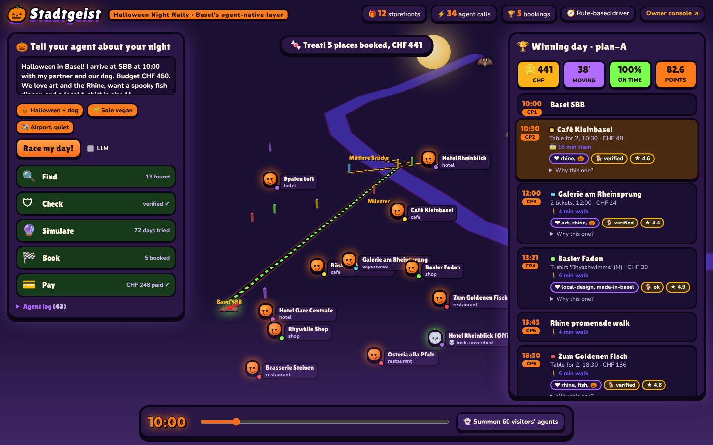

# Stadtgeist

Stadtgeist is a small working model of Basel in which a café, a gallery, or a hotel publishes one record an agent can read, check, and book. The record says what the place offers, when it is open, which claims the owner stands behind, and what an agent is allowed to do there. A planner takes a visitor's wish for a whole day, tries combinations of those places against walking time, trams, opening hours, and a budget, and books the day that still holds together.

This is our entry for BaselHack 2026, Adobe's challenge on what a local business publishes once agents do the searching and the booking. The longer story, a Saturday in Basel in 2032, is in [`docs/VISION.md`](docs/VISION.md).



## What happens when you run it

A visitor writes something ordinary: arriving at Basel SBB at 10:00 with a dog, CHF 450 to spend, and a day that should include art, the Rhine, a fish dinner, and a local t-shirt. The planner asks the city's registry for storefronts. Listings that are not signed by a key the registry trusts are dropped, including a cheap lookalike hotel that signed itself. The rest are turned into timed days. Each day is replayed a few hundred times with late trams and long lunches, so a plan that only works if everything is perfectly on time loses. The days that survive are booked in two steps: every stop is held, then every hold is confirmed. If one hold fails, the others are released and the planner tries again with whatever is still free.

The same record is what the owner edits. On the owner page they can type "We're full at 19:30, vegan risotto today" and that sentence is signed again and becomes visible to agents. They can turn slots on and off, decide whether agents may only read or may also book, and see which agents came by. A separate run lets 60 made-up visitors plan the same day, which shows up as a rough forecast of tomorrow: which business, which hour.

Someone who is not an agent still gets a normal page at `/b/<business-id>`, generated from that same signed record, with schema.org JSON-LD and a link to the MCP endpoint.

Under the hood the planner only talks to businesses over MCP (Streamable HTTP). Signatures are Ed25519. Holds, confirmations, and declines are enforced by each storefront on the server.

## Where to look in the code

| Piece | What it does | Where |
|---|---|---|
| Storefronts | Each business is its own MCP server: `get_business_card`, `check_availability`, `hold`, `confirm`, `cancel` | `src/mcp.js`, `/mcp/<business-id>` |
| Signed claims | Things like "dogs welcome" or "check-in until 02:00" are signed with the business key. A tourism desk can attest a claim after checking it. A reviews body signs ratings | `src/crypto.js`, `src/world.js` |
| Registry | Directory of storefronts. The registry signs each listing, so a self-signed copy ("Rhine Hotel Deals 24", CHF 89) is rejected | `/mcp/registry` |
| Agent policy | The owner sets what agents may do: read, hold, book, cancel; verified agents only; a maximum party size. Café Frühling, in this demo, allows reading and refuses booking, so the planner sends people there as walk-ins | `agentPolicy` in `data/businesses.js` |
| Agent passport | One credential from the Basel Agent Trust Network. Every storefront accepts it | `issueAgentPassport` |
| Intent mandate | The payment credential is tied to the merchant, item, amount, and date the visitor approved. A charge that does not match is declined before it goes through | `issueMandate`, `checkIntent` |
| Planner | Finds businesses, checks signatures, builds timed days, scores them, explains the pick, then books with rollback if a hold fails | `src/agent/` |
| Language model | Optional. Qwen through any OpenAI-compatible API (local Ollama, or a cloud endpoint such as OpenRouter) or Claude reads the free-text wish and calls the same tools. With no model configured, a fixed planner runs the same MCP steps | `src/agent/llm.js` |
| Many visitors | Sixty synthetic agents plan the day. Their plans become the per-business, per-hour forecast | `src/agent/swarm.js` |
| City twin | A 3D Basel. Beacons pulse on each MCP call. The chosen day is drawn and walked by an avatar. Other simulated days show up as ghosts, along with swarm trails and demand pillars | `public/` |
| Owner console | Plain-language updates, slot toggles, agent permissions, live visits, and the forecast | `/owner.html` |
| Human page | The signed record rendered for a person | `src/humanPage.js`, `/b/<business-id>` |

## Run it

Node 20 or newer.

```bash
npm install
npm start                       # http://localhost:4000
```

If a language model is available, the planner uses it. Otherwise it uses the fixed planner and still calls the same storefront tools.

| Setup | What to do |
|---|---|
| Qwen on this machine, no API key | `ollama pull qwen3`, leave Ollama running, then `npm start`. It is picked up on its own. |
| Qwen in the cloud | `cp .env.example .env` and set `LLM_BASE_URL`, `LLM_API_KEY`, and `LLM_MODEL` |
| Claude | Set `ANTHROPIC_API_KEY` in `.env` |

- City twin: http://localhost:4000/
- Owner console: http://localhost:4000/owner.html
- Same planner from the terminal: `npm run agent -- "Arriving Basel SBB 10:00 with my dog, CHF 450, art, Rhine, fish dinner, t-shirt size M"`
- End-to-end checks: `npm test`

The 3D map uses OpenFreeMap tiles when you are online, and a drawn Basel when you are not.

### Any other MCP client

Each storefront is an ordinary MCP server:

```bash
claude mcp add --transport http basel-registry http://localhost:4000/mcp/registry
claude mcp add --transport http hotel-rheinblick http://localhost:4000/mcp/hotel-rheinblick
```

Then ask that client for a dog-friendly hotel near the Rhine in Basel on 14 Nov, and to hold a room. The beacon for that hotel pulses in the city twin while the call is in flight.

## Walking through a demo

About three minutes, in the running app.

1. **Owner.** Open the owner console for Ufer7. Type "We're full at 19:30, vegan risotto today" and publish. The claim is signed again and agents can see it.
2. **Visitor.** In the city twin, enter: "I arrive at SBB 10:00 with my partner and our dog, CHF 450, art, Rhine, fish dinner, a local t-shirt." Beacons pulse as storefronts are queried. The copycat hotel is rejected. Dozens of day plans are simulated, a couple survive the dog rules and the budget, and the chosen day is booked with signed receipts.
3. **A bad charge.** Click *Try to misuse the mandate*. A charge at another shop, outside what was approved, is declined.
4. **The day itself.** Press play. An avatar walks the booked day through the 3D city.
5. **Tomorrow.** Run *Simulate 60 visitors' agents*. The crowd shows up on the map, and the owner console shows the fish house peaking around 18:00.

## Project layout

```
data/businesses.js     real Basel places (public web data) plus the simulated storefront layer
src/world.js           live city state: inventory, holds, bookings, trust anchors, mandates
src/mcp.js             storefront and registry MCP servers
src/agent/             planner, language-model loop, swarm, city model
src/ownerAssistant.js  plain-language owner updates
src/humanPage.js       human page from the same signed record
public/                city twin and owner console
scripts/               terminal agent and end-to-end smoke test
```

The 12 businesses are real places in Basel. Names, addresses, opening hours, cuisine, and listed prices come from public web pages, and each record keeps a `source`. Live availability, inventory, agent policies, signatures, attestations, and bookings are simulated; each record lists those under `simulated`. Claims marked "(demo)" are made up for the scenario. Stadtgeist is not affiliated with these businesses. The spoof listing is fictional.

## License

MIT. See [LICENSE](LICENSE).
